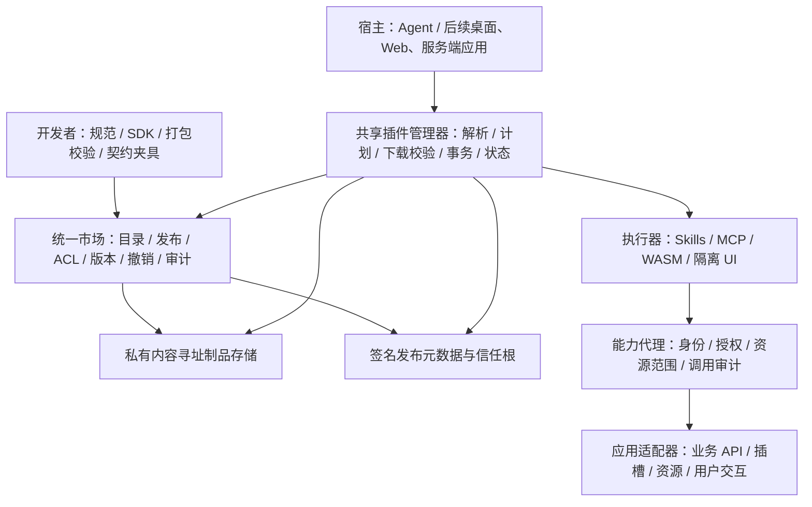

# EOS 统一插件平台架构

日期：2026-11-03。状态：架构已采纳；内部市场与 Agent 接入已实现并进行本地验收。

已确认的产品方向：自建服务器承载市场，当前仅内部开放；统一 EOS 系列插件系统，以 EOS Agent 为第一个宿主，未来产品按同一契约接入。实际支持矩阵见 [宿主接入](docs/HOST-INTEGRATION.md)，测试与尚未执行的发布事项见 [实施与验收](docs/IMPLEMENTATION-plugin-platform-v1.md)。未宣告的执行器和业务能力仍必须拒绝。

规范入口：[v1 契约](docs/SPEC-plugin-platform-v1.md)、[架构决策](docs/ADR-001-unified-plugin-platform.md)、[实施与验收](docs/IMPLEMENTATION-plugin-platform-v1.md)。

## 1. 统一到什么程度

一个市场、一套插件身份与包规范、一套安装与授权语义、一个版本化宿主协议；不同应用实现自己的业务能力和界面插槽。

接入统一系统意味着能使用相同的发现、鉴权、分发、校验、兼容判定、生命周期、诊断和权限机制。能运行某一个具体插件，仍取决于该宿主实际具备的能力、执行器和授权。不能把“接入平台”当成“兼容所有插件”。

插件支持两种适用范围：

- `portable`：仅依赖已标准化的能力，不绑定产品 ID。新宿主通过对应能力和执行器的符合性测试后，即可按契约运行。
- `targeted`：声明具体应用与可选宿主版本范围，且仍检查能力版本。应用 ID 不从插件 ID 推断。

“已在某产品验证”是市场中独立的、绑定发布摘要的验证记录。它与声明兼容分开显示，未来宿主不能自动获得“已实测”标签。

## 2. 改造前代码基线

本节是本地源码观察，不是线上数据盘点。用户说明当前尚无正式插件；实施切换时仍需只读盘点实际数据库和本地安装，不能因样例或模板存在就删除数据。

- `eos-plugins/plugins.json`：静态索引，包含三个样例条目，其中有示例仓库地址，不能视为三个可用插件。
- `eos-core-rs/.../services/plugin_index.rs`：默认读取 `https://dl.eosaios.com/plugins.json`，按名称、描述和标签搜索。
- `eos-core-protocol/src/plugin.rs`、`services/plugin_manager.rs`：`plugin.toml`、本地复制或 Git clone、名称索引、权限确认及 MCP/Skills 组合；没有统一的平台发布与永久身份模型。
- `eos-core-app-server/src/lib.rs`：安装后走现有 `mcp_upsert`；列表与卸载通过现有 RPC 暴露。
- `eos-app-src/frontend/src/workbench.tsx`：已有市场搜索、安装、确认权限和卸载的界面流程。
- `eos-base/.../plugin.rs`、`services/plugins.rs`、`web/shared/plugin-kit`：后台页面插件已有 ID、版本、上传、发布及摘要；包为 `.eos-plugin` tar.gz、入口是 `plugin.json`；JS 在宿主页面中求值，依赖注入绑定了现有 Web 宿主。

可复用的是既有扩展能力、账号、存储、审计、管理界面和部分发布基础。现有字段、`admin/user` 宿主枚举、全局 JS 注册及裸 API 客户端不作为新的跨产品标准。

## 3. 四层结构与依赖方向

1. **规范与开发工具层**：唯一清单格式、发布模型、错误码、能力协议、SDK 与符合性夹具。
2. **市场控制层**：产品无关的目录、发布、鉴权、受控下载、兼容性查询、撤销与管理后台。服务器保存包，不因包被上传就执行包。
3. **共享运行层**：兼容判断、依赖解析、安装事务、授权与状态机；执行器通过接口注册，不嵌入产品名单。
4. **宿主适配层**：产品声明自己的能力、执行环境和 UI 插槽，通过代理调用本产品 API。

初期市场作为现有服务器的模块部署，复用数据库、对象存储和后台；不增加必须独立维护的市场微服务。高开销扫描或托管插件执行任务通过独立工作进程完成，不能进入账号/支付主服务进程。后续可按同一 API 拆分部署。

## 4. 规范、代码与产品规则的归属

- **`eos-plugins`**：演进为规范与开发入口，保存清单 Schema、API/能力定义、协议夹具、生成规则、SDK 发布说明和开发模板。规范版本与插件版本独立。
- **产品中性的共享插件组件**：建议独立 `eos-plugin-protocol`、`eos-plugin-policy`、`eos-plugin-runtime`；先放在 `eos-plugins` 的共享实现工作区，产物供 base 与 Core 单向依赖，不能依赖 Agent、base 或 pro 业务。目录为实施建议，当前未创建这些 crate。
- **`eos-base`**：通用市场领域模型、存储、API、鉴权、签名发布流程和通用后台。使用应用注册数据，不硬编码 EOS 产品键。
- **`eos-base-pro`**：EOS 应用注册、官方发布者初始化、内部可见策略、产品能力与权益组合、EOS 文案。依赖方向保持 `pro → base`。
- **`eos-core-rs`**：嵌入共享管理器，提供原生执行器、MCP/Skills 桥接、审批及资源适配。现有 `eos-core-protocol` 引用或重导出共享 DTO，不维护第二份字段定义。
- **`eos-app-src` / `eos-cli`**：桥接、界面、安装进度与人机交互；生命周期和权限裁决留在共享运行层/Core。
- **其他 EOS 产品**：使用宿主 SDK 或同一版本的 sidecar 协议，注册自己的能力和插槽。Web 宿主不需要捆绑完整 Agent。

Schema 和协议定义只有一个源：`eos-plugins` 的版本化 Schema/能力定义。Rust/TypeScript 类型、Go 桥接类型及文档接口由此生成，生成结果再跑同源夹具；不能只靠几组测试掩盖三份手写字段长期漂移。确定性策略实现共享，不能让浏览器和服务端各写一个权限引擎。

## 5. 身份和版本模型

永久 ID 采用 `publisher.slug`，例如 `eos.document-tools`。发布者为经过平台管理的命名空间；显示名称、作者文案、仓库 URL 都不承担身份职责。改名不更换 ID，删除后也不释放 ID 给其他发布者。

区分以下对象：

- **Plugin**：插件永久身份与发布者归属。
- **Release**：某 ID 的 SemVer 版本，携带一份不可变清单。
- **Artifact**：某发布的目标平台制品，摘要定位；同一目标元组最多一个。
- **Channel pointer**：某环境、可见受众及频道指向哪个已发布版本；不改包内容。
- **Installation**：特定账户、宿主实例和作用域的安装与启用状态。
- **Grant**：特定安装对能力、资源范围及有效期的授权。
- **Host registration**：应用及能力定义。服务器鉴权使用受信身份中的应用标识，不能相信请求里任意填写的应用 ID。
- **Verification**：某发布、宿主构建和能力组合的实际验证结果。

包可以复用；安装、启用、授权、凭据和业务数据不跨应用自动共享。跨应用服务调用必须走服务 API 与其自身权限。

## 6. 插件包与执行形态

统一根清单采用 **`plugin.toml`**，使用标准 TOML 解析器转成规范对象后校验 Schema。保留 Agent 的开发习惯，同时重做身份与能力契约；后台旧 `plugin.json` 用一次性转换工具迁入，运行时仅保留新格式。

`.eos-plugin` 保持 tar.gz 容器。一个发布可有 portable 或特定平台制品，拥有相同清单摘要，选择规则明确，不在安装时拉取浮动依赖。文档、许可证、图标、技能及运行资源均在制品中校验；具体文件布局见 v1 契约。

执行器独立注册：

- `skills/v1`：声明式知识/提示内容，使用宿主已有审批执行实际操作。
- `mcp-stdio/v1`：本地进程 MCP，必须声明真实隔离或显式受信进程等级。
- `mcp-http/v1`：远程 MCP，端点与凭据授权单独管理。
- `wasm-component/v1`：受限计算及版本化能力导入。固定所需 WIT 世界与运行时 ABI；未实现该 ABI 的宿主明确不兼容。
- `webview/v1`：沙箱页面及消息协议，可提供页面、面板、配置等贡献；不共享宿主 React/Solid/Vue 实例。

服务器业务插件若需要后台任务，以独立执行器/受控工作进程运行并走能力代理，不动态加载共享库到账号、支付或数据库主进程。

## 7. 宿主接入的最小合同

宿主通过 `HostDescriptor` 公布应用 ID、宿主 API 版本、环境、平台、执行器及能力的版本与约束。通过 `HostAdapter` 提供：

1. 已认证的当前主体与作用域，以及切换/退出通知。
2. 能力注册、资源访问和执行取消。
3. 配置、数据存储、凭据库和额度限制。
4. 权限确认、文件/资源选择及操作审批。
5. 可用界面插槽和贡献注册/注销。
6. 安装状态、日志、诊断及迁移挂钩。

能力按命名空间版本化，例如 `eos.fs.read@1`、`eos.ui.panel@1`、`eos.todo.tasks.write@1`。应用版本和能力版本分别检查；通用插件不读取某产品私有数据库、DOM、路由或内部 SDK。

Web/非 Rust 宿主使用同源生成的 SDK 与协议；确定性策略代码可编译为 WASM 复用，本机 I/O、进程、存储实现由平台适配器提供。浏览器不声明原生进程执行器；要使用托管计算必须显式选择远程执行位置、权限及计费，不能自动转到服务器。

## 8. 权限与隔离边界

有效权限是清单请求、用户授权、当前主体权限、宿主限制、服务端策略和执行器实际可执行限制的交集。市场可见、包签名可信和插件有权读某条业务数据是三个不同判断。

- 所有代理调用绑定插件实例、版本摘要、模块、应用、主体、作用域及取消令牌；不相信插件自报身份。
- 默认不给插件账号 Cookie、登录令牌、数据库连接、宿主裸 HTTP 客户端或未筛选会话内容。
- UI 通过隔离 origin/沙箱 iframe 或独立 WebView 加消息端口通信；导航、网络、弹窗、下载及原生桥按策略关闭或代理。
- WASM 不因支持 WASI 就得到任意目录、环境或网络访问；按能力导入。
- 任意本地进程并不天然受清单约束。平台无法真实限制时，仅允许经过额外批准的 `trusted-process`，显式说明继承用户级本机权限；不能把声明式文件权限显示成沙箱承诺。
- `sandboxed-process` 只有对应 OS 的隔离适配器通过逃逸与限制测试后才公布；不能静默退化为受信进程。
- 升级新增能力、资源范围、执行位置或信任等级需要重新授权。退出或切换账号撤销句柄、订阅和进程，不能让旧主体上下文继续运行。

## 9. 发布、运行与失败处理

发布固定字节、摘要和签名元数据；签名信任根独立于目录 HTTP 响应。目标采用 TUF 角色/元数据模型，区分根密钥、目标、快照和时间戳；不自行发明只有一个包摘要的“验签”。内部下载同样鉴权，私有存储不提供永久匿名 URL。

安装先生成绑定摘要的计划，再授权、下载、验证、暂存、提交、激活。权限确认后不能重新克隆一个可能变化的分支。升级按安装作用域串行，旧版本保持到新版本成功；失败恢复明确的旧状态，禁止半注册 MCP、Skills 或 UI。

普通下架停止新安装；安全撤销停止相应版本激活、终止可控实例并撤销代理句柄。离线设备只能在有效的已验证策略租约内运行，不能承诺即时远程撤销。受信本机进程已经执行的外部副作用无法撤回。

配置/数据升级必须有快照、显式版本与恢复策略；任意业务副作用不能靠包回滚撤销。确需不可逆数据升级的版本禁止静默自动升级，安装计划提前披露并要求专门确认。

## 10. 初始内部运营与后续开放

第一部署为内部模式：账号/组织白名单，发布者仅官方，目录、详情、解析、签名元数据、包与静态资源都受访问控制。搜索无权看到的插件时不能泄露其名称、版本或摘要。

后续开放是启用已设计的受众 ACL、发布者审核、扫描、配额、举报和撤销流程；下载、身份、包及宿主协议保持不变。计费通过基座权益接口接入；支付和产品规则不进入运行内核。

Dev/test 与 Beta/Stable/生产使用独立凭据、数据、签名根与发布指针。插件频道与应用发布频道分开表达，但环境身份受客户端构建及受信配置约束，插件不能切换市场到另一环境。

## 11. 交付边界

这次交付是完整架构、v1 契约与可判定的实施验收基线。没有变更现有运行路径、数据库或服务器配置，也没有创建生产插件、发版或部署。实现工作应按本规范的纵向闭环逐步验证，不能把“有上传页面”当成统一平台完成。

## 参考依据

- [MCP 架构](https://modelcontextprotocol.io/specification/2025-11-25/architecture)：MCP 提供工具连接协议，宿主管理权限和生命周期；不覆盖整个插件市场合同。
- [WebAssembly Component Model](https://component-model.bytecodealliance.org/)：版本化组件和宿主接口；本设计不绑定“当前最新版”作为未经验证的实现依赖。
- [HTML iframe sandbox 标准](https://html.spec.whatwg.org/multipage/iframe-embed-object.html#attr-iframe-sandbox)：隔离 UI 的平台基础，需要同时约束 origin、网络和消息桥。
- [TUF 角色与元数据](https://theupdateframework.io/docs/metadata/)：制品摘要、角色签名、元数据有效期和更新信任模型。
